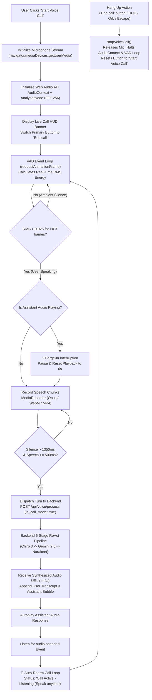

# Amirlan [Speech-to-Speech Voicebot Agent]
https://amirlan.onrender.com/

## System Architecture & Workflows

### 1. Continuous Real-Time Voice Call Workflow (Client VAD + Barge-In)



### 2. Backend 6-Stage ReAct Loop & Knowledge Grounding Pipeline

```mermaid
flowchart LR
    subgraph S1["Stage 1: Speech Intake (STT)"]
        AudioIn["Audio Payload (.webm / .mp4)"] --> STT["Google Cloud Speech-to-Text v2\nChirp 3 Neural Model (mn-MN)"]
        STT --> Breaker{"Consecutive Unclear\nCircuit Breaker"}
        Breaker -- ">= 3 times" --> EscCircuit["Trip Human Escalation"]
        Breaker -- "Transcribed" --> Transcript["Transcript Text (mn-MN)"]
    end

    subgraph S2["Stage 2: Intent Classification"]
        Transcript --> IntentClassifier["Gemini 2.5 Flash Classifier\nDeposit | Loan | Card | App | Transfer"]
        IntentClassifier --> IntentMeta["Intent Category & Confidence Score"]
    end

    subgraph S3["Stage 3: Hybrid Knowledge Retrieval (RAG)"]
        IntentMeta --> Retriever["Hybrid Retriever (< 1ms)\nFAISS Cosine Similarity + BM25"]
        KB[("Knowledge Base\napp/knowledge_base/*.md\n01_deposits, 02_mortgage, etc.")] --> Retriever
        Retriever --> Context["Ranked Top Chunks & Official URLs"]
    end

    subgraph S4["Stage 4: ReAct Reasoning & Grounding"]
        Context --> ReActLoop["Gemini 2.5 Flash ReAct Engine\nThought -> Action -> Observation"]
        ReActLoop --> EvalDecision{"Completeness & Safety Check\nRequires Live Agent?"}
    end

    subgraph S5["Stage 5: Neural TTS Response"]
        EvalDecision -- "Answerable & Grounded" --> CleanText["Formulate Spoken Response\n(No repetitive boilerplate)"]
        CleanText --> TTS["Narakeet Neural TTS API\nPersona: Ankhmaa or Ganbaatar"]
        TTS --> AudioFile["Generated Audio (.m4a)"]
    end

    subgraph S6["Stage 6: Human Escalation"]
        EvalDecision -- "Human Transfer Needed" --> EscProtocol["Escalation Protocol\nPriority Routing"]
        EscCircuit --> EscProtocol
        EscProtocol --> HotLine["24/7 Contact Center 1800-1917\nInternational: +976 7515-1917"]
    end

    AudioFile --> FinalResponse["Return JSON Payload\n(transcript, response_text, audio_url, stage_logs)"]
    HotLine --> FinalResponse
```



## Setup

```bash
pip install -r requirements.txt
```

Set your API keys and credentials — either:
```bash
export NARAKEET_API_KEY="your_narakeet_key"
export GOOGLE_CLOUD_PROJECT="your_gcp_project"
export GCP_LOCATION="us-central1"
```
Or create a `.env` file:
```
NARAKEET_API_KEY=your_narakeet_key
GOOGLE_CLOUD_PROJECT=your_gcp_project
GCP_LOCATION=us-central1
```

For Google Cloud credentials, authenticate using:
```bash
gcloud auth application-default login
```

## Run

```bash
python run.py
```
Then open http://localhost:5005

Or with Docker:
```bash
docker build -t mn-voicebot .
docker run -d -p 5005:5005 --env-file .env mn-voicebot
```

## Deploying to Render.com

1. In Render Dashboard, go to your Web Service -> **Environment**.
2. Add the following environment variables:
   - `GOOGLE_CREDENTIALS_JSON`: Copy & paste the complete JSON text from your Google Cloud Service Account key or local ADC (`cat ~/.config/gcloud/application_default_credentials.json`).
   - `NARAKEET_API_KEY`: Your Narakeet TTS API key.
   - `GOOGLE_CLOUD_PROJECT`: Your GCP project ID (e.g. `project-1d76ba00-25b9-47dd-8d3`).
   - `GCP_LOCATION`: `us-central1`.
3. Check `https://<your-service>.onrender.com/api/status` to verify `has_speech_client: true` and `has_vertex_llm: true`.

## Connecting your local knowledge base

In `app/knowledge_base/`, add or update topic-specific markdown files (e.g., `01_deposit_products.md`, `02_cards_and_digital_banking.md`):

```markdown
# Хаан Банкны Хадгаламжийн Үйлчилгээ
- Хугацаатай хадгаламж (Төгрөг): Жилийн хүү 12.0% - 14.4%.
- Хугацаагүй хадгаламж (Төгрөг): Жилийн хүү 3.6% - 4.8%.
- Хүүхдийн хадгаламж: Жилийн хүү 13.2% - 14.0%.
```

The retriever in `app/vector_store.py` automatically parses, chunks, and indexes all markdown files into a local FAISS vector store with hybrid BM25 re-ranking (< 1ms).

## Configuring the Voicebot Agent & Voices

In `app/voicebot.py`, customize the agent model, TTS voice, and response parameters:

```python
# Configure Vertex AI Gemini model
self.llm = ChatVertexAI(
    model="gemini-2.5-flash",
    project=self.project_id,
    location=self.gcp_location,
    temperature=0.0,
    max_output_tokens=1000,
    thinking_budget=0
)

# Supported Mongolian voice personas: "Ankhmaa" (Female) or "Ganbaatar" (Male)
DEFAULT_VOICE = "Ankhmaa"
```

## Structure

```
mn-voicebot-agent/
├── app/
│   ├── app.py              # Flask server & REST API endpoints
│   ├── voicebot.py         # 6-Stage Amirlan Voicebot Agent & guardrails
│   ├── vector_store.py     # Local FAISS vector store & hybrid RAG retriever
│   ├── knowledge_base/     # Grounded Khan Bank product knowledge base
│   ├── templates/
│   │   └── index.html      # Voicebot web UI & Developer Mode dashboard
│   └── static/
│       ├── css/style.css   # Dark theme & 6-stage telemetry card
│       └── js/app.js       # Audio recording visualizer & chat client
├── Dockerfile              # Production Linux container with audio drivers
├── requirements.txt        # Python dependencies
└── run.py                  # Server launcher
```
