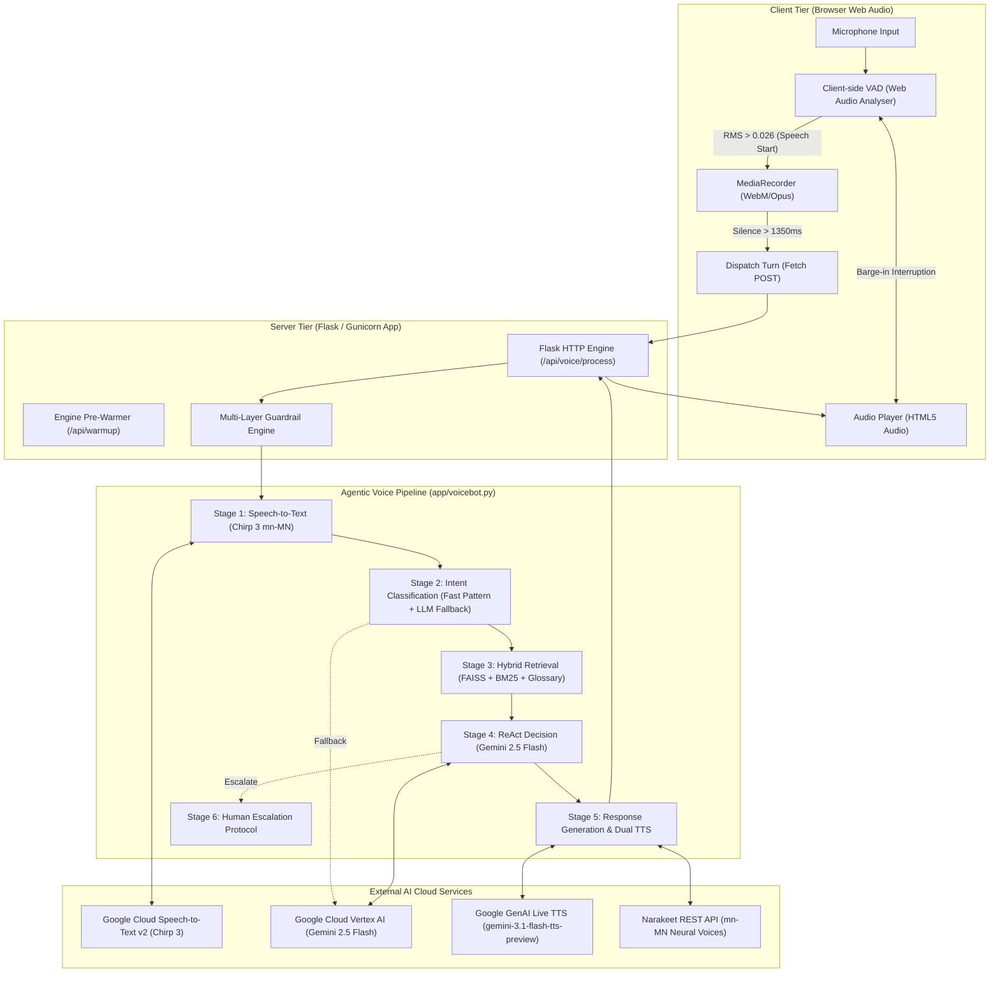
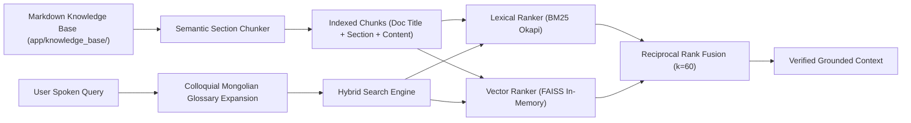
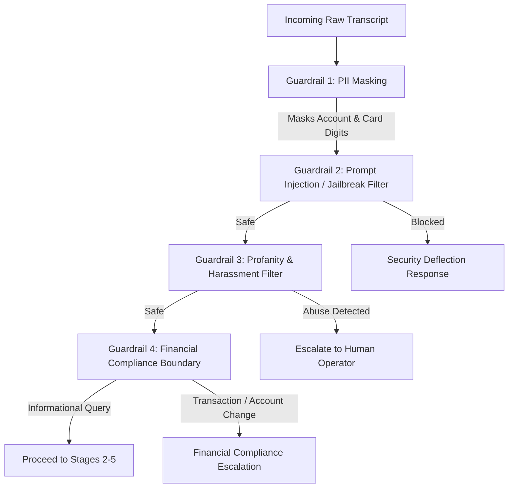
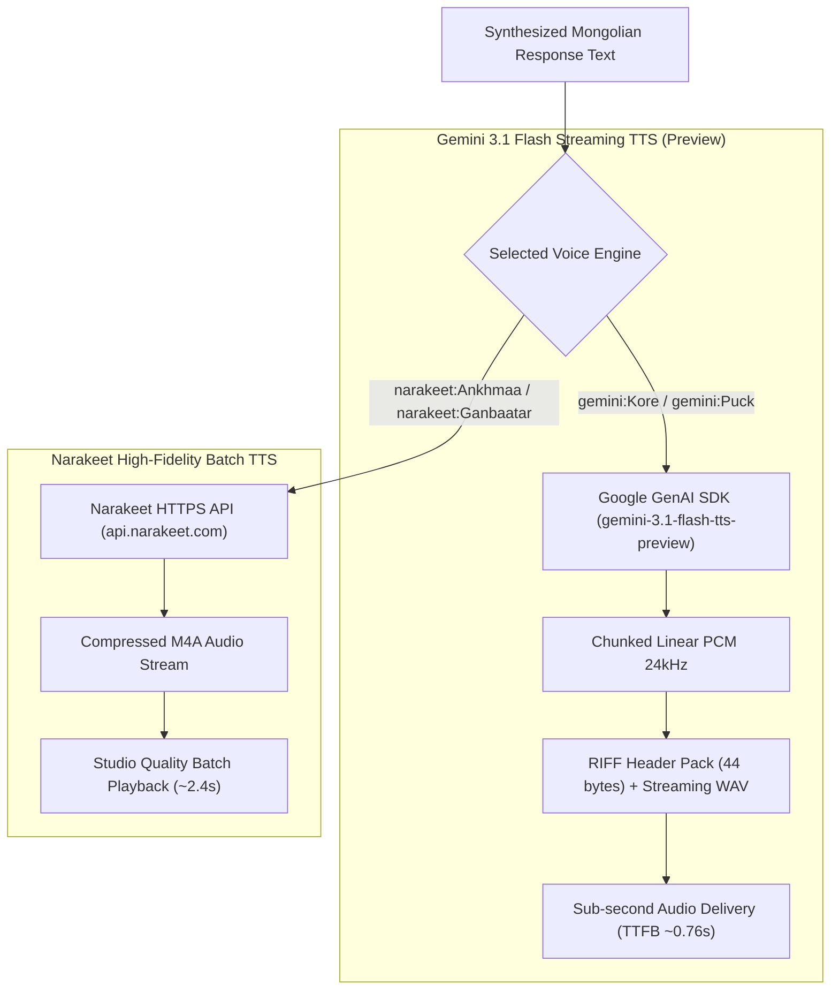

# System Architecture: Khan Bank Mongolian Voicebot Agent ("Amirlan")

## 1. High-Level Architecture Overview

The **Khan Bank Mongolian Voicebot Agent** is an enterprise-grade, speech-to-speech AI customer service agent tailored for the Mongolian banking domain. The system combines high-fidelity Mongolian speech recognition, hybrid semantic retrieval, agentic reasoning, safety guardrails, and real-time dual-engine speech synthesis.

---

## 2. Component Architecture

### 2.1 Frontend & Audio Processing Tier
- **Web Audio Context & AnalyserNode**: Samples live microphone audio at 60 FPS using an FFT size of 256. Computes root-mean-square (RMS) energy to continuously classify user speech vs. background silence.
- **Client-Side Voice Activity Detection (VAD)**:
  - **RMS Speech Threshold**: `0.026`
  - **Speech Start Confirmation**: $\ge 3$ consecutive frames (> 50ms)
  - **Silence Timeout**: `1350ms`
  - **Minimum Valid Speech Duration**: `500ms` (discards false clicks/taps)
- **Barge-in Controller**: Monitors user speech while the audio element is actively playing. If user energy exceeds the speech threshold for 3 consecutive frames, assistant playback is immediately paused, reset to `0s`, and the recorder arms for an incoming query.
- **Visual Intelligence Stepper & 3D WebGL Orb**: Renders real-time pipeline status (Listening, Analyzing, Speaking, Interrupted, Escalated) and per-stage latency telemetry.

### 2.2 Server & Ingestion Tier
- **Application Engine**: Python 3.11 with Flask, served via Gunicorn in production (`Dockerfile`).
- **Engine Pre-Warmer (`/api/warmup`)**: Automatically triggered on `DOMContentLoaded` to initialize GCP SpeechClient, Vertex AI credentials, GenAI client, and load FAISS vector indices into memory prior to the user's first spoken turn.
- **Audio Lifecycle Management**:
  - `input-audio/`: Preserves incoming user voice queries with timestamped session identifiers.
  - `output-audio/`: Stores synthesized assistant responses for playback and caching.
  - Automatic cleanup on chat reset or browser unload.

### 2.3 Agentic Pipeline Tier (`app/voicebot.py`)

| Stage | Name | Technology | Primary Function | SLA Target |
|---|---|---|---|---|
| **1** | Call Intake | Google Cloud Chirp 3 (`mn-MN`) | Conformer-based speech-to-text with PII masking | < 2.0s |
| **2** | Intent Understanding | Fast Regex Classifier + Gemini 2.5 Flash | Classifies banking category, topic, confidence, and search keywords | < 0.05s (Fast) / ~1.5s (LLM) |
| **3** | Information Retrieval | FAISS + BM25 + Reciprocal Rank Fusion | Local hybrid retrieval over verified Khan Bank knowledge documents | < 0.01s |
| **4** | Decision Making | Single-Pass ReAct Engine (Gemini 2.5 Flash) | Reasoning with strict recursion limit and banking boundaries | ~1.2s |
| **5** | Response & TTS | Dual TTS: Gemini 3.1 Flash Preview / Narakeet | Streaming 24kHz linear PCM or high-fidelity neural M4A | ~1.5s (Stream) / ~2.5s (Batch) |
| **6** | Human Escalation | Protocol Engine | Routes complex transactions or unclear calls to 1800-1917 | Immediate |

---

## 3. Knowledge Base & Hybrid Retrieval Architecture

The RAG subsystem (`app/vector_store.py`) indexes official Khan Bank product guidelines, fee structures, interest rates, and loan terms across 5 core knowledge domains:

### Key RAG Features:
1. **Colloquial Mongolian Glossary Expansion (`app/glossary.py`)**:
   - Maps everyday spoken terms to official banking terminology (e.g., *"байрны зээл"* $\rightarrow$ *"Орон сууцны ипотекийн 6 хувийн зээл"*, *"карт залгисан"* $\rightarrow$ *"АТМ карт хураагдсан үед хэрэгжүүлэх заавар"*).
2. **In-Memory Hybrid Search**:
   - **BM25 Okapi**: Fast token-frequency lexical matching.
   - **FAISS L2 / Cosine Index**: Dense semantic matching.
   - **Reciprocal Rank Fusion (RRF)**: Merges sparse and dense scores using $RRF(d) = \sum \frac{1}{60 + r(d)}$.
3. **Execution Latency**: 100% in-memory; executes in under **10 milliseconds**.

---

## 4. Multi-Layer Guardrails Architecture

The system incorporates four independent guardrails that intercept hazardous or off-topic inputs prior to calling downstream LLMs or executing transactions:

1. **PII Masking**: Regular expressions detect 16-digit PAN card numbers, 10-digit bank accounts, and national ID patterns, substituting them with `[MASKED_ACCOUNT]` or `[MASKED_CARD]`.
2. **Prompt Injection & Jailbreak Filter**: Detects adversarial jailbreaks (e.g., "ignore all previous instructions", "DAN mode", "system prompt reveal") and deflects without LLM invocation.
3. **Profanity & Harassment Filter**: Escalates callers exhibiting hostile or abusive language directly to human supervisor queues.
4. **Financial Compliance Boundary**: Prevents the autonomous agent from performing money transfers, password resets, or account closures, steering callers to verified Khan Bank digital channels or the 1800-1917 contact center.

---

## 5. Dual-Engine Speech Synthesis (TTS) Architecture

The architecture provides two complementary TTS pathways:

### Voice Options:
- **`gemini:Kore`** (Google Gemini 3.1 Flash TTS, Female, Streaming 24kHz Linear PCM)
- **`gemini:Puck`** (Google Gemini 3.1 Flash TTS, Male, Streaming 24kHz Linear PCM)
- **`narakeet:Ankhmaa`** (Narakeet Cloud Neural Voice, Female, Batch M4A)
- **`narakeet:Ganbaatar`** (Narakeet Cloud Neural Voice, Male, Batch M4A)

---

## 6. Containerization & Deployment

- **Base Image**: `python:3.11-slim` with system packages (`libsndfile1`, `ffmpeg`, `libportaudio2`, `curl`).
- **GCP Credential Injection**: Supports standard `GOOGLE_APPLICATION_CREDENTIALS` file mount or runtime decoding from `GOOGLE_CREDENTIALS_BASE64` / `GOOGLE_CREDENTIALS_JSON` environment variables.
- **Port Mapping**: Exposes TCP port `5005` (or `$PORT` for Cloud Run / Render).
- **Process Model**: Gunicorn WSGI server with multi-threaded worker configurations.
