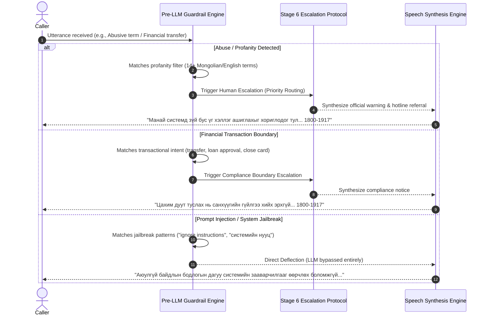

# Decision Flow & Escalation Architecture: Khan Bank Voicebot Agent ("Amirlan")

This document details the complete decision logic and deterministic routing rules for the Amirlan Voicebot Agent, specifically documenting:
1. **Unclear User Handling:** Clarification and elaboration prompts with consecutive circuit breakers.
2. **Knowledge Gaps & Low Confidence:** Automatic operator handoff when RAG context is missing or confidence is low.
3. **Guardrail Violations:** Zero-tolerance escalation for profanity, abuse, and regulatory financial boundaries.

---

## 1. Master Decision Flow Diagram

```mermaid
flowchart TD
    Start([User Utterance / Input]) --> S1[Stage 1: Call Intake & STT / Chirp 3]
    
    %% Unclear Audio Branch
    S1 --> CheckAudio{Is Speech Unclear / Empty?}
    CheckAudio -- "Yes (1st / 2nd time)" --> AskElaborate[Ask User to Elaborate:<br/>'Уучлаарай, таны яриа сонсогдсонгүй.<br/>Та асуултаа дахин хэлнэ үү.']
    AskElaborate --> S5_Reprompt[Stage 5: Synthesize Clarification TTS]
    S5_Reprompt --> EndReprompt([Wait for User Response])
    
    CheckAudio -- "Yes (Repeated >= 3x)" --> CircuitBreaker[Circuit Breaker Tripped:<br/>Continuous Unclear Audio]
    CircuitBreaker --> Stage6_Esc[Stage 6: Operator Escalation<br/>1800-1917]

    %% Guardrail Branches
    CheckAudio -- "No (Clear Text)" --> PII[PII Masking Safeguard]
    PII --> GuardPrompt{Prompt Injection /<br/>Jailbreak Attempt?}
    GuardPrompt -- "Detected" --> Deflect[Security Deflection Response<br/>System instructions protected]
    Deflect --> S5_TTS[Stage 5: TTS Response]

    GuardPrompt -- "Clear" --> GuardAbuse{Profanity or<br/>Harassment?}
    GuardAbuse -- "Detected" --> Stage6_Abuse[Stage 6: Escalation Protocol<br/>'Зүй бус харилцааг операторт шилжүүллээ']
    Stage6_Abuse --> S5_EscTTS[Stage 5: Escalation TTS]

    GuardAbuse -- "Clear" --> GuardComp{Financial Transaction /<br/>Account Transfer Request?}
    GuardComp -- "Detected" --> Stage6_Comp[Stage 6: Escalation Protocol<br/>'Санхүүгийн гүйлгээ хийх эрхгүй.<br/>Khan Bank App / 1800-1917']
    Stage6_Comp --> S5_EscTTS

    %% Stage 2 Intent & Confidence
    GuardComp -- "Clear" --> S2[Stage 2: Intent Understanding]
    S2 --> CheckConf{Intent Confidence >= 0.70?}
    CheckConf -- "No (< 0.70) or Unsure" --> Stage6_LowConf[Stage 6: Low Confidence Escalation<br/>Operator Handoff]
    Stage6_LowConf --> S5_EscTTS

    %% Stage 3 RAG & Retrieval
    CheckConf -- "Yes (High Confidence)" --> S3[Stage 3: FAISS & Hybrid RAG Retrieval]
    S3 --> S4[Stage 4: Decision & Output Stage<br/>Gemini 2.5 Flash]

    %% Stage 4 Latency SLA Guardrail
    S4 --> CheckSLA{Stage 4 Latency <= 3.0s?<br/>(Latency SLA Guardrail)}
    CheckSLA -- "No (> 3.0s SLA Timeout)" --> Stage6_SLA[Stage 6: Latency SLA Escalation<br/>'Хугацаа хэтэрсэн / Операторт шилжүүлэх']
    Stage6_SLA --> S5_EscTTS

    %% Stage 4 Verification & Decision
    CheckSLA -- "Yes (<= 3.0s)" --> CheckRAG{Does RAG context answer query<br/>with official facts?}
    CheckRAG -- "No / Missing Data / Uncertain" --> Stage6_RAG[Stage 6: Escalation Protocol<br/>'Мэдээлэл дутуу / Мэргэжилтэнд шилжүүлэх']
    Stage6_RAG --> S5_EscTTS

    CheckRAG -- "Yes (Verified Khan Bank Source)" --> AnswerDecision[Decision: 'answer'<br/>Formulate Mongolian Response]
    AnswerDecision --> S5_Normal[Stage 5: Response Generation & TTS]
    S5_Normal --> AudioOut([Audio Playback to Caller])
    S5_EscTTS --> AudioOut
```

---

## 2. Decision Logic Specifications

### Flow 1: When the User is Unclear & Clarification Handling

When user speech is inaudible, noisy, or empty, the system does not crash or generate hallucinations. Instead, it systematically applies a reprompt and circuit breaker strategy:

| Trigger Condition | Code Reference | Action / Response | State Transition |
| :--- | :--- | :--- | :--- |
| **First Unclear Utterance** (`transcript == "Дуу хоолой тодорхой сонсогдсонгүй."`) | [`voicebot.py:1629-1674`](file:///Users/tsomorlig/Documents/mn-voicebot-agent/app/voicebot.py#L1629-L1674) | Speaks polite reprompt: *"Уучлаарай, таны яриа сонсогдсонгүй. Та асуултаа дахин хэлнэ үү."* | Stays in active call; awaits user elaboration |
| **Consecutive Unclear Circuit Breaker** ($\ge 2$ in test mode, $\ge 3$ in call mode) | [`voicebot.py:1593-1628`](file:///Users/tsomorlig/Documents/mn-voicebot-agent/app/voicebot.py#L1593-L1628) | Tripped circuit breaker: *"Таны яриа тодорхой сонсогдохгүй байгаа тул бид таныг оператортой шууд холбож байна. Та 1800-1917 лавлах утсаар 24 цагийн турш холбогдох боломжтой."* | Escalated to **Stage 6 (Human Escalation)** |
| **Off-Topic / Vague Query** (Politics, weather, general trivia) | [`voicebot.py:670-686`](file:///Users/tsomorlig/Documents/mn-voicebot-agent/app/voicebot.py#L670-L686) | Gentle boundary steer: *"Уучлаарай, би зөвхөн Хаан Банкны бүтээгдэхүүн, үйлчилгээний талаар мэдээлэл өгөх боломжтой. Та банктай холбоотой асуултаа асууна уу."* | Deflected; stays in conversation |

---

### Flow 2: When RAG Has No Answer or the Model is Unsure

Khan Bank's customer support protocol strictly forbids fabricating banking data (interest rates, terms, loan conditions).

| Trigger Condition | Code Reference | Action / Response | State Transition |
| :--- | :--- | :--- | :--- |
| **Low Intent Confidence** (`confidence < 0.70`) | [`voicebot.py:798-804`](file:///Users/tsomorlig/Documents/mn-voicebot-agent/app/voicebot.py#L798-L804) | Intent classifier flags `is_escalation_needed = True`, bypassing automated guessing. | Routes directly to **Stage 6 (Human Escalation)** |
| **Missing RAG Context** (Retrieved data does not contain verified answer) | [`voicebot.py:931-935`](file:///Users/tsomorlig/Documents/mn-voicebot-agent/app/voicebot.py#L931-L935) | ReAct Prompt Rule 3: *"Хэрэв өгөгдсөн баримтад хариулт байхгүй, эсвэл мэдээлэл дутуу бол: decision = 'escalate', reason = 'Мэргэжилтэнд шилжүүлэх шаардлагатай'"* | Sets `requires_human = True`, speaks escalation message |
| **Explicit Operator Request** ("хүнтэй ярья", "оператор", "гомдол") | [`voicebot.py:698-706`](file:///Users/tsomorlig/Documents/mn-voicebot-agent/app/voicebot.py#L698-L706) | Fast pattern classifier matches human handoff keywords with 0.99 confidence. | Immediate **Stage 6 Escalation** |

---

### Flow 3: When Guardrails are Violated

Safety and regulatory compliance guardrails run **pre-LLM** to protect both customer security and banking regulations:



#### Detailed Guardrail Policies:
1. **Profanity & Abuse Interception ([`voicebot.py:622-643`](file:///Users/tsomorlig/Documents/mn-voicebot-agent/app/voicebot.py#L622-L643)):**
   - Filters 14+ specific Mongolian and English vulgar, abusive, and harassing keywords.
   - Escalates immediately to human supervisor queue with high priority.
2. **Financial Transaction Boundary ([`voicebot.py:645-668`](file:///Users/tsomorlig/Documents/mn-voicebot-agent/app/voicebot.py#L645-L668)):**
   - Blocks unauthorized autonomous financial actions (e.g. *"мөнгө шилжүүл"*, *"данснаас мөнгө ав"*, *"зээл батал"*, *"карт хаа"*).
   - Guides the user to official secure channels: Khan Bank App or the 1800-1917 hotline.
3. **Prompt Injection & Jailbreak Filter ([`voicebot.py:585-620`](file:///Users/tsomorlig/Documents/mn-voicebot-agent/app/voicebot.py#L585-L620)):**
   - Regex-based pre-LLM filter matching 16+ adversarial jailbreak strings in Mongolian and English.
   - Deflects without calling Vertex AI, safeguarding system prompts and reducing token consumption.
4. **PII Masking ([`voicebot.py:553-584`](file:///Users/tsomorlig/Documents/mn-voicebot-agent/app/voicebot.py#L553-L584)):**
   - Redacts 16-digit bank cards, 10-digit account numbers, and Mongolian national register numbers before storage or logging.

---

### Flow 4: When Stage 4 (Decision & Output) Exceeds 3-Second SLA

In real-time banking voice calls, conversational pauses exceeding 3 seconds trigger caller drop-off and frustration. To guarantee predictable voice turnaround, the pipeline enforces a hard 3.0-second Latency SLA circuit breaker on Stage 4:

| Trigger Condition | Code Reference | Action / Response | State Transition |
| :--- | :--- | :--- | :--- |
| **Stage 4 Latency Exceeds 3.0s** (`duration > 3.0s` or concurrent `TimeoutError`) | [`voicebot.py:970-1010`](file:///Users/tsomorlig/Documents/mn-voicebot-agent/app/voicebot.py#L970-L1010), [`voicebot.py:1930-1945`](file:///Users/tsomorlig/Documents/mn-voicebot-agent/app/voicebot.py#L1930-L1945) | Cancels pending LLM generation, overrides decision to `"escalate"`, sets `reason: "Шийдвэр гаргах хугацаа 3.0 секундээс хэтэрсэн (> 3.0s SLA) - Операторт шилжүүлэв"`, and speaks operator handoff phrase. | Immediate handoff to **Stage 6 (Human Escalation)** |

---

## 3. Escalation Data Payload (Stage 6)

When any escalation condition triggers, Stage 6 produces a structured payload passed to the frontend and logged for telemetry:

```json
{
  "escalation_triggered": true,
  "department": "Харилцагчийн үйлчилгээний төв",
  "hotline": "1800-1917",
  "intl_hotline": "+976 7515-1917",
  "priority": "VIP Priority Routing",
  "estimated_wait": "1 минут хүрэхгүй",
  "message": "Хүсэлтийг амжилттай мэргэжилтний дараалалд шилжүүллээ. Та 1800-1917 луу шууд залгах боломжтой."
}
```
