# Stage-by-Stage Optimizations & Latency Profiling

## 1. Overview of Pipeline Performance Engineering

The Khan Bank Mongolian Voicebot Agent ("Amirlan") is engineered to minimize end-to-end conversational turn latency while maintaining high precision on complex Mongolian banking queries. This document details how each stage was optimized, what latencies are achieved, and where remaining performance bottlenecks reside.

```mermaid
gantt
    title Typical End-to-End Voice Turn Latency Breakdown (~6.8s Total)
    dateFormat X
    axisFormat %s s

    section Stage 1: STT
    Chirp 3 Neural STT (Google Cloud) :0, 2000
    section Stage 2: Intent
    Fast Regex Pre-Classifier / LLM Fallback :2000, 3200
    section Stage 3: RAG
    In-Memory FAISS + BM25 Retrieval :3200, 3210
    section Stage 4: ReAct
    Gemini 2.5 Flash Decision & Response :3210, 4800
    section Stage 5: TTS
    Gemini 3.1 Flash Stream / Narakeet :4800, 6800
```

---

## 2. Stage-by-Stage Optimizations

### Stage 1: Call Intake & Speech-to-Text (Chirp 3)
- **Engine**: Google Cloud Speech-to-Text v2, `chirp_2` / `chirp_3` Conformer foundation model for `mn-MN`.
- **Applied Optimizations**:
  1. **Direct Audio Pass-Through**: The browser captures WebM/Opus and passes bytes directly to SpeechClient v2 without redundant intermediate disk serialization.
  2. **Streaming Recognizer Reuse**: The gRPC connection to `us-speech.googleapis.com` is established once during the pre-warming phase and reused across conversational turns.
  3. **In-Flight PII Regex Sanitization**: Strips and masks citizen identification numbers, 16-digit payment card numbers, and 10-digit bank account numbers in $< 0.5\text{ms}$ before logging or storing.
  4. **Character & Token Clamping**: Text queries are clamped to 500 characters to prevent prompt bloat and unnecessary inference costs.
- **Latency Profile**: **1.5s – 2.0s** (driven by 2B-parameter acoustic model attention across remote Google Cloud inference nodes).

---

### Stage 2: Intent Understanding
- **Engine**: Dual-Path Intent Classifier (`app/voicebot.py:understand_intent`).
- **Applied Optimizations**:
  1. **Fast Sub-Millisecond Pattern Classifier**: Evaluates prioritized regex and substring rules for frequent banking domains (`loan_inquiry`, `account_service`, `card_service`, `branch_atm`, `exchange_rate`, `human_escalation`). When a rule matches, execution completes in **$< 0.5\text{ms}$**.
  2. **Structured JSON Low-Token Fallback**: If an unusual phrasing does not match the fast patterns, the system falls back to a condensed Gemini 2.5 Flash classification prompt requesting strictly formatted JSON.
- **Latency Profile**:
  - **Fast Path (Keyword Hit)**: **$< 0.001s**
  - **Fallback Path (LLM Call)**: **1.0s – 1.8s**

---

### Stage 3: Information Retrieval (Local Hybrid RAG)
- **Engine**: `LocalKnowledgeRetriever` in [`app/vector_store.py`](file:///Users/tsomorlig/Documents/mn-voicebot-agent/app/vector_store.py).
- **Applied Optimizations**:
  1. **Zero External Network Dependencies**: All 5 Khan Bank knowledge base documents are chunked and pre-indexed into memory using FAISS and BM25 Okapi.
  2. **Colloquial Mongolian Banking Glossary (`app/glossary.py`)**: Pre-processes customer colloquialisms (e.g., *"байрны зээл"*, *"карт залгисан"*, *"свифт код"*) into official terminology before scoring.
  3. **Reciprocal Rank Fusion (RRF)**: Combines dense vector similarity and sparse lexical relevance scores with reciprocal rank constant $k=60$ in $< 2\text{ms}$.
  4. **Strict Context Pruning**: Returns only the single highest-scoring grounded chunk with its source URL (`khanbank.com`), keeping downstream LLM prompts concise.
- **Latency Profile**: **0.002s – 0.010s (< 10ms)**.

---

### Stage 4: Decision Making (Single-Pass ReAct Engine)
- **Engine**: Gemini 2.5 Flash via Google Cloud Vertex AI (`app/voicebot.py:streamlined_agent_workflow`).
- **Applied Optimizations**:
  1. **Single-Pass Consolidation**: Merged what was previously two separate LLM steps (thought/decision step + response generation step) into a unified single-pass inference prompt.
  2. **Strict Recursion Limit**: Restricts internal agent iterations to 1 (`recursion_limit=2`), eliminating multi-step tool call loops for standard banking questions.
  3. **Voice Brevity Constraints**: Prompt instructs the LLM to output at most 1–2 sentences ($\le 24$ words, $\le 130$ characters) without markdown headers, bullet points, or repetitive greeting formulas.
  4. **System Prompt Compression**: Reduced prompt instructions to essential rules only, lowering token generation latency.
- **Latency Profile**: **1.0s – 1.8s**.

---

### Stage 5: Response Generation & Speech Synthesis (Dual TTS)
- **Engines**: Google Gemini 3.1 Flash Streaming TTS Preview vs. Narakeet Cloud Neural Voice.
- **Applied Optimizations**:
  1. **Gemini 3.1 Flash Streaming TTS**:
     - Consumes `generate_content_stream` requesting native `AUDIO` modality.
     - Delivers 24kHz linear PCM audio chunks with a Time-To-First-Byte (TTFB) of **~0.76s**.
     - Automatically packages linear PCM chunks into standard 44-byte RIFF WAV headers.
  2. **Narakeet Batch TTS**:
     - Utilizes `requests.Session()` with persistent TCP/TLS keep-alive connections to `api.narakeet.com`, avoiding repeated TLS handshake penalties (~300ms saved per turn).
     - Streams binary data into disk chunks with `stream=True` and 8KB buffer writes.
     - **Complete Speech Guarantee**: Configured with `max_bytes=800` (up to 350 Mongolian Cyrillic characters) to prevent audio cutoff.
     - **ReAct Prompt Alignment**: Injects a strict constraint (*"1-2 товч өгүүлбэрээр хариул"*) specifically for optimized Narakeet, ensuring LLM output length harmonizes with batch audio synthesis.
     - **Unoptimized Baseline**: Features a side-by-side benchmarking voice (`narakeet:Ankhmaa:unoptimized`) bypassing connection pooling, streaming disk writes, caching, and prompt limits to measure optimization impact directly.
  3. **Two-Tier Response & Phrase Memoization Cache**:
     - **Tier 1 (Frequent Phrases)**: Pre-synthesizes standard phrases (greetings, operator escalations, clarification requests).
     - **Tier 2 (Full Pipeline Memoization)**: Caches `{voice:transcript}` pairs. Repeat questions return in **$< 0.02\text{s}$** without invoking STT, LLM, or TTS.
- **Latency Profile**:
  - **Gemini 3.1 Flash TTS**: **~0.76s TTFB** (streaming), **1.5s – 2.0s** full file download.
  - **Narakeet Optimized Batch TTS**: **2.2s – 2.8s** full file download.
  - **Narakeet Unoptimized Batch TTS**: **4.5s – 7.5s** full file download (fresh TLS, uncompressed buffer, raw text).
  - **Cache Hit**: **0.01s – 0.02s**.

---

### Cold-Start Mitigation: Page-Open Warmup
- **Mechanism**: [`POST /api/warmup`](file:///Users/tsomorlig/Documents/mn-voicebot-agent/app/app.py#L40) triggered by `DOMContentLoaded` in [`app/static/js/app.js`](file:///Users/tsomorlig/Documents/mn-voicebot-agent/app/static/js/app.js#L1618).
- **Warmup Actions**:
  1. Instantiates Google Cloud SpeechClient (`speech_v2.SpeechClient`).
  2. Initializes Vertex AI credentials and LangChain ChatVertexAI (`gemini-2.5-flash`).
  3. Initializes Google GenAI client (`genai.Client`) for Gemini 3.1 Flash TTS.
  4. Reads and indexes all Markdown documents in `app/knowledge_base/` into the FAISS and BM25 engines.
- **Result**: Eliminates cold-start penalties on the first user voice query, reducing first-turn latency from > 14s down to steady-state performance.

---

## 3. SLA & Latency Comparison Table

| Pipeline Component | Unoptimized / Cold | Optimized Steady-State | Memoized Cache Hit | Primary Latency Driver |
|---|---|---|---|---|
| **Page-Open Warmup** | ~6.5s (blocking call) | 0.0s (background pre-warm) | N/A | SDK & FAISS index initialization |
| **Stage 1 (Chirp 3 STT)** | 3.5s | 1.5s – 2.0s | 0.01s | Remote 2B Conformer neural attention |
| **Stage 2 (Intent)** | 2.5s (LLM) | 0.001s (Fast) / 1.5s (LLM) | 0.00s | Fallback LLM inference over network |
| **Stage 3 (RAG Retrieval)**| 0.8s (external DB) | 0.002s – 0.010s | 0.001s | Local RAM execution (FAISS + BM25) |
| **Stage 4 (ReAct Decision)**| 3.8s (multi-turn) | 1.0s – 1.8s | 0.01s | Gemini 2.5 Flash token generation |
| **Stage 5 (TTS)** | 4.2s (sequential) | 1.5s (Gemini) / 2.4s (Narakeet)| 0.01s | Remote audio generation & download |
| **TOTAL TURN-AROUND** | **14.8s – 20.0s** | **5.5s – 7.5s** | **0.02s** | **Cumulative sequential AI API calls** |
