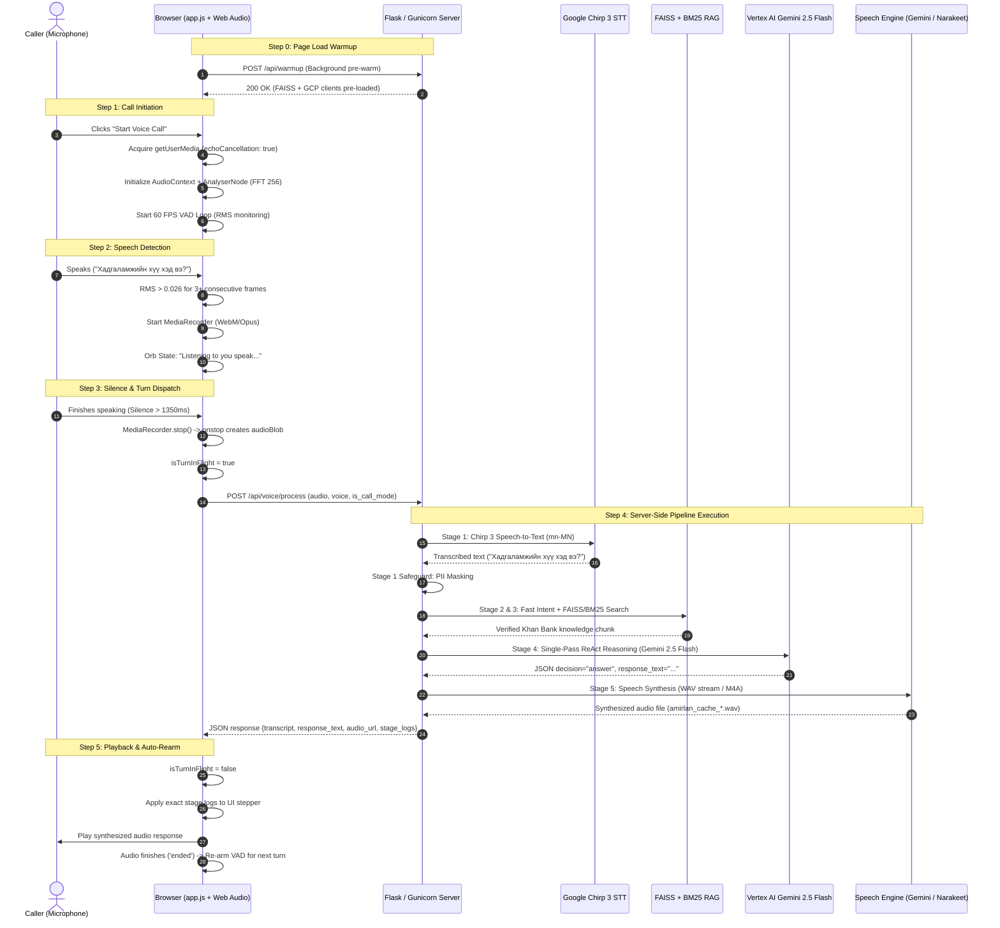
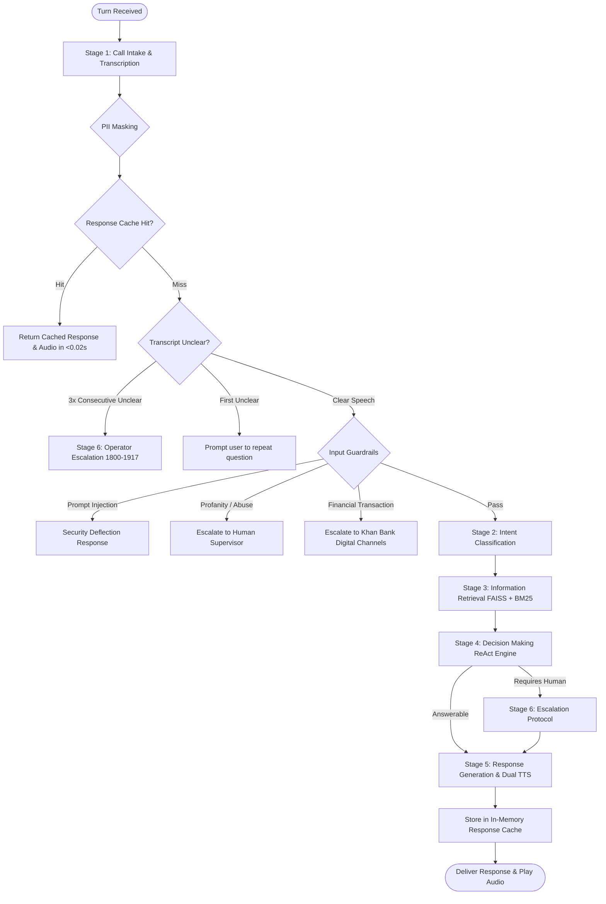
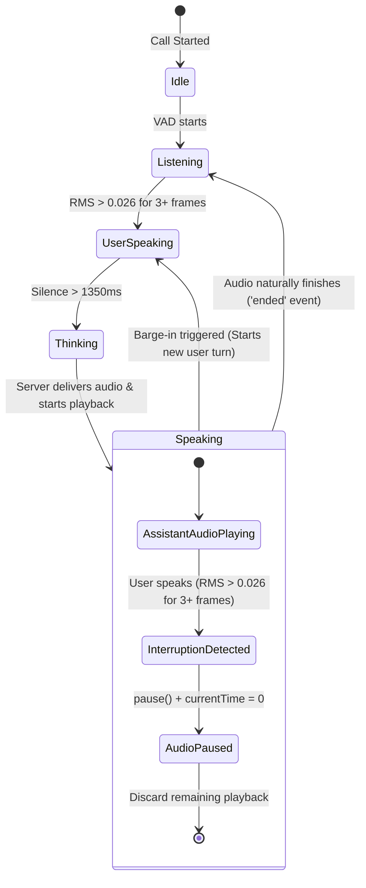

# Operational Workflows: Khan Bank Voicebot Agent ("Amirlan")

## 1. End-to-End Voice Call Lifecycle

The continuous voice call operates through an asynchronous state machine driven by browser Web Audio API, client-side Voice Activity Detection (VAD), and server-side agentic processing.



---

## 2. 6-Stage Agentic Reasoning Loop

Every incoming customer turn is processed through a deterministic 6-stage pipeline in [`app/voicebot.py`](file:///Users/tsomorlig/Documents/mn-voicebot-agent/app/voicebot.py):



### Stage Details:

1. **Stage 1: Call Intake & Transcription**
   - Transcribes audio using Google Cloud Speech-to-Text v2 Chirp 3 (`mn-MN`).
   - Applies regex-based PII masking to remove account numbers, credit card digits, and citizen registration IDs.
2. **Stage 2: Intent Understanding**
   - High-speed pattern classifier checks keyword categories (`loan_inquiry`, `account_service`, `card_service`, `branch_atm`, `exchange_rate`, `human_escalation`).
   - If no pattern matches, falls back to a low-token Gemini 2.5 Flash classification prompt.
3. **Stage 3: Information Retrieval**
   - Expands query with colloquial Mongolian banking glossary (`app/glossary.py`).
   - Executes hybrid retrieval via in-memory BM25 + FAISS vector search (`app/vector_store.py`).
   - Returns verified context chunk with official Khan Bank source URL.
4. **Stage 4: Decision Making (ReAct Engine)**
   - Formulates single-pass prompt enforcing banking compliance, brevity (<24 words for voice), and strict grounding in retrieved knowledge.
   - Evaluates whether to answer directly (`"decision": "answer"`) or transfer to a specialist (`"decision": "escalate"`).
5. **Stage 5: Response Generation & TTS**
   - Synthesizes audio using either Google Gemini 3.1 Flash Streaming TTS (24kHz linear PCM) or Narakeet Neural Batch TTS (M4A).
   - Memoizes `{voice:query}` response pair in cache for instant sub-20ms hits on repeat questions.
6. **Stage 6: Human Escalation Protocol**
   - Generates structured routing ticket: contact hotline (`1800-1917`), department assignment, priority, and caller summary.

---

## 3. Barge-In & Interruption Handling Workflow

Barge-in allows callers to interrupt the AI voicebot naturally while it is speaking, mirroring a real human telephone call.



### Interruption State Mechanics (`app/static/js/app.js`):
1. **Detection Window**: While `currentlyPlayingAudio` is playing (`isAssistantSpeaking = true`).
2. **Trigger Condition**:
   - `rms > SPEECH_RMS_THRESHOLD` (0.026) for $\ge 3$ consecutive frames (~50ms).
3. **Action Executed**:
   ```javascript
   currentlyPlayingAudio.pause();
   currentlyPlayingAudio.currentTime = 0;
   bargeInTag.textContent = "⚡ Interrupted!";
   ```
4. **Transition to Recording**:
   - `isUserSpeaking = true`
   - `vadRecorder.start(100)` begins recording the new question immediately.
   - When user stops speaking (silence > 1350ms), the new question is dispatched to `/api/voice/process`.

---

## 4. Operational Circuit Breakers & Safeguards

The voicebot enforces safety circuit breakers to prevent infinite loops, hallucinated advice, and adversarial exploitation:

| Circuit Breaker | Trigger Condition | Automated Action | Target SLA |
|---|---|---|---|
| **Turn Limit Breaker** | Session turns $\ge 12$ | Automatic Stage 6 escalation to human agent (`1800-1917`) | Instant |
| **Consecutive Unclear Breaker** | 3 consecutive unclear audio turns | Automatic escalation to telephone operator | Instant |
| **Prompt Injection Breaker** | Jailbreak or system prompt reveal keyword | Blocks LLM call; delivers pre-compiled security deflection | < 0.01s |
| **Financial Boundary Breaker** | Autonomous money transfer, password reset | Escalates with instructions to use Khan Bank App or branch | Instant |
| **Off-Topic Query Steering** | General knowledge / non-banking queries | Polite deflection steering user back to Khan Bank services | < 0.01s |
